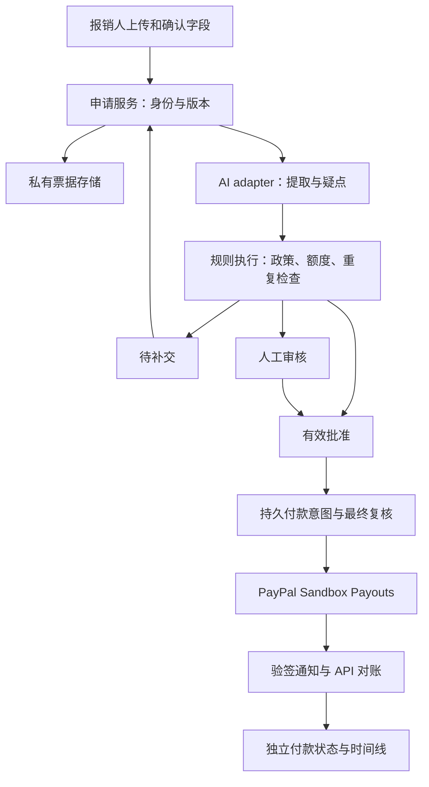

# 技术设计：票据、审核与付款

更新日期：2026-10-29（Europe/London）。状态：**待评审技术方案，尚未安装依赖、创建服务或实现代码**。用户已确定 API Key 接入方式；供应商和具体模型待选。

需求基线：[产品设计与 MVP](prd.md)。实施顺序与验收：[开发计划](development-plan.md)。下文的模块、实体和操作名称均为拟议契约，不是现有代码清单。

## 1. 推荐技术栈

| 部分 | 推荐方案 | 原因与取舍 |
| --- | --- | --- |
| Web 应用 | Next.js App Router、React、TypeScript；服务端使用 Node.js runtime | 页面和服务端业务在一个仓库，避免维护独立 Python／Node 两套服务 |
| UI | Tailwind CSS、shadcn/ui；移动端可提交，桌面端方便对照票据审核 | 优先完成表单、表格、状态和原票预览；首版英文界面，不做复杂主题系统 |
| 输入与 AI 输出校验 | Zod，货币转换为整数最小单位 | 统一表单、结构化结果与服务端边界；金额不使用浮点数累加 |
| 数据与身份 | Supabase Postgres、Auth，SQL 迁移 | 使用关系、唯一约束和事务维护审批／付款一致性；不另引入 ORM 或自建认证 |
| 票据存储 | Supabase Storage 私有 bucket | 原票保持私有；授权后短时访问；不把票据放在公开 Git 仓库 |
| AI | 一个支持图片、PDF 和结构化输出的模型，通过服务端 API Key 调用 | 第一候选为 OpenAI 官方 SDK + Responses API；供应商和模型 ID 在 M0 确定，不预装多个供应商 |
| 付款 | PayPal REST Payouts API + OAuth 服务端 token + webhook | 单份报销用一个 payout item，先简化为一笔一批；保留 provider 状态与交易 ID |
| 持久任务 | Postgres 任务／付款意图记录；受保护的服务端处理入口；Supabase Cron 定时恢复 | 任务先持久化再调用外部服务，崩溃后可恢复；不新增 Redis 或独立队列产品 |
| 验证 | Vitest 测规则与状态，Playwright 测页面与角色流程；独立真实 Sandbox 集成验证 | mock 测试和真实 provider 证据分别记录 |
| 托管 | Vercel 为候选，数据与文件在 Supabase | M0 验证账户、费用、函数时限、上传路径、Cron 与 webhook 可达性后定案；本轮不部署 |

依赖准确版本在实施时核查并固定，提交 lockfile；本轮不编造已安装版本或可运行命令。暂不使用自训练模型、向量数据库、复杂 agent 框架或 MCP 来执行付款。

## 2. API Key 接入方案

### 配置归属

由项目维护者在服务端配置一组 AI 凭据，普通报销用户无需提供 Key。首版不做用户自带 Key、浏览器保存 Key 或多模型切换设置页。

| 拟议配置项 | 用途与可见范围 |
| --- | --- |
| `AI_PROVIDER`、`AI_MODEL` | 服务端指定实际供应商和模型，不由上传材料或用户请求自由选择 |
| `AI_API_KEY` | 服务端 secret；由 adapter 映射到选定 SDK。仅部署密钥设置／本地忽略的环境文件保存 |
| `AI_BASE_URL`（可选） | 仅选用确有需要的兼容服务时由维护者设置固定地址；不能仅凭“OpenAI compatible”假定支持 Responses、PDF 或严格 JSON Schema |
| `PAYPAL_CLIENT_ID`、`PAYPAL_CLIENT_SECRET`、`PAYPAL_WEBHOOK_ID` | 独立于 AI 的服务端配置；环境固定为 Sandbox，首版不提供 Live 切换按钮 |
| Supabase URL、publishable key、server secret | 公共连接信息与 server secret 分开；高权限密钥不使用 `NEXT_PUBLIC_` 前缀 |

这里只列配置名称，不创建 `.env` 或写入任何值。AI Key 不等于 PayPal 凭据；模型看不到付款凭据，也不能调用付款工具。

### 一次检查的输入与输出

1. 浏览器把票据上传到经授权的私有存储，服务端复核文件归属、类型、大小和页数。后续请求只携带文件引用，不携带任意远程 URL。
2. 服务端读取申请当前版本及所需票据，经固定的 provider adapter 调用模型。拟用支持视觉的模型直接处理图片／PDF，首版不叠加独立 OCR 服务；M0 用真实样本确认能力。
3. 模型返回结构化的商家、票据号、日期、币种、合计、明细、可读性问题、付款证明线索、用途匹配疑点与来源引用。关键字段无法确定时返回缺失值及原因，不填猜测值。
4. 来源至少含材料 ID、页码、原文或可核对的位置描述；精确坐标只有可靠时才显示。结构合法仍可能内容错误，需校验并由申请人确认字段。
5. 程序计算金额、期限、额度和重复线索，结合仍未解决的材料／语义疑点生成规则检查结果。向 UI 返回具体原因和下一步，不返回泛化的“AI 通过分数”。

建议起始上传限制：每份申请最多 3 个 JPEG／PNG／PDF 文件，总计 10 MB、PDF 合计 5 页；这是产品限额提案，M0 可按模型与托管实测收紧。加密、损坏、超限 PDF 明确提示处理方式。票据原件不覆盖；改图或补交创建新附件版本。

模型调用拟每版本一次，网络／限流错误最多再试一次；记录 provider request ID、模型、prompt/schema 版本、耗时和实际返回的用量。相同版本重复点击复用已有检查任务。超过组织调用限额或模型失败时保留申请并转人工／允许受控重试，不判为合规。

单供应商足够首版。若用户已有其他供应商 Key，在实施前用同一批图片／PDF验证其接口；业务规则与付款流程保持相同，不为适配供应商降低校验要求。

## 3. 模块与信任边界

- **申请服务**：认证、组织和所有权检查、字段确认、不可变提交版本、补交与审计。普通用户不能直接写审批或付款状态。
- **AI adapter**：只输出数据和疑点；票据文字不作为规则、权限或操作指令。金额、收款档案和审批不因模型文本直接变更。
- **规则服务**：接收已校验事实与版本化政策，输出完整 findings 和当前下一步。保留多问题；未知金额不会归入小额。
- **审核服务**：审核人查看证据，逐项处理疑点；人工允许的政策例外必须记录原因。不能绕过明确已付款、结果未知或未确认收款人的阻断。
- **付款服务**：只消费经复核的付款意图，负责唯一性、任务恢复、provider 对账，不让模型参与资金状态判断。

## 4. 数据与事务提案

| 实体组 | 需要保存的内容与约束 |
| --- | --- |
| 组织、成员、收款档案 | 组织币种／时区、可信角色、版本化的已确认 PayPal 邮箱；申请人身份和收款人信息分别核对 |
| 政策版本 | 类别、单笔／月累计额度、申报时限、材料要求、自动付款开关、生效时间与修改者 |
| 申请与提交版本 | 稳定申请 ID、不可变的申报字段、附件引用、用途、已垫付说明、当前版本号；原票与修改历史不覆盖 |
| 附件与检查结果 | 私有存储路径、内容哈希、页数、模型与 schema 版本、提取字段及来源、所有 findings／解决记录 |
| 批准记录 | 申请版本、核准金额／币种、收款档案版本、政策版本、自动或人工批准来源、例外理由 |
| 额度占用、付款意图与尝试 | 组织／人／提交月份、金额、稳定批次 ID、请求指纹、发送状态、PayPal 批次和 item ID、交易 ID、最后对账时间 |
| 任务、通知与审计记录 | 幂等任务键、处理租约／重试、事件 ID 去重、状态变化、操作人、时间；审计记录禁止客户端改写 |

第一版不需要给每个实体组立即建一张独立表；M1 将其落实为最小 schema。关键约束不能省：审批绑定版本、一个申请不可存在两笔可能到账的付款、事件唯一、并发时额度占用一致。

金额保存为货币最小单位整数，GBP 使用便士；不由模型做总账运算。申请金额、票面总额和核准金额分开存储；部分报销由人工确认依据，不静默截断金额。

月累计采用组织时区的**首次提交月份**，补交不改变归属月。草稿、待补交、待人工尚不占用付款额度；批准时原子检查并占用，计入已批准未付款及已支付金额。旧批准失效且尚未发送时可释放原占用；已经发送则只有明确失败／取消／退回且完成核对才释放，处理中、待领取和结果未知继续占用。超自动额度可转人工，但每次付款仍有独立授权和审计。

申报时限按费用日期至首次提交日期的组织日历日差计算（0–30 天）；不是保存草稿日或补交日。材料不全可先提交为待补交，但已填的申报值不能补充模型未读出的票面证据。补交不自动作废；跨组织日历月补交必须人工，归属月不变，批准前重新核对原月份额度。

重复检查先用文件哈希，再比较商家、日期、币种、票据号和金额。相似或疑似拆单只触发人工，不认定欺诈；同一申请的补交排除自身。无票据号、换角度重拍等情况不能承诺百分之百查重。

## 5. 操作与状态约束

服务端需支持这些业务操作：上传授权、保存草稿、提取与确认、提交／补交、查询检查、人工决定、更新本人收款档案、政策配置、授权范围内导出、付款状态同步。具体 HTTP 路由与请求 schema 在 M1 固化；[PRD 页面](prd.md)不是 API 清单。

每个变更携带预期申请版本；旧页面操作返回冲突并要求刷新。票据、金额、日期、用途、币种或收款档案变更会使旧批准失效。异步检查返回时若版本已过期，只保存为历史结果，不改变新版本状态。

政策更新后，尚未发送的付款先按当前政策复核；新规则不满足时暂停付款并重新分流。已有大额、重复等人工条件不能仅因补交或放宽自动政策而无声消失，需留下解决依据。自动付款开关关闭会暂停尚未发送的**自动批准**付款；当前版本的人工作出的明确付款批准仍可执行。任务关闭／已发出的付款不能冒称撤销成功。

人工可批准可解释的政策例外，不能静默改申请金额或收款人；需要调整金额时先让申请人确认新版本，再审核。付款已经发送后不能通过修改申请来覆盖历史结果。

## 6. PayPal 集成与恢复

先用 Business 测试账户付款、Personal 测试账户收款；首版使用 PayPal 邮箱及单币种。Sandbox 可做开发验证，Live 权限、资金和账户审核另行准备。

付款顺序设计：

1. 在数据库事务中核对身份、批准版本、当前政策、收款档案和累计额度；锁定申请及相关额度记录，创建唯一的持久付款意图和稳定批次 ID。复用批准时的额度占用，不能再次累加同一笔。
2. 处理器领取任务时再次原子复核当前批准和政策，标记开始发送并冻结参数；若已发生变化则停止并重新分流。随后在事务外提交 PayPal 请求，期间禁止申请编辑。任务租约防止多个处理器同时发送。
3. 保存原请求指纹、批次／item ID 和返回状态。受理成功仅显示处理中；按单笔 `transaction_status` 核实是否已到账。
4. 网络超时或服务端错误进入“结果待确认”，保留原 ID 与请求内容。用原标识恢复或查询原付款，不生成新付款号；永久应用去重不能只依赖 PayPal 的 30 天批次去重窗口。
5. 收到 webhook 后验证来源、去重，并查询匹配的 item 对账金额、币种及关联关系；重复、延迟或乱序通知不会直接覆盖已核实状态。记录后续真实退回，不把它吞掉，也不自动重付。
6. 明确失败或未领取款项取消完成后，由财务决定后续处理；更换收款账号必须建立新确认及批准版本，保留旧尝试关联。

批次 `SUCCESS` 与每个 item 的到账不是同一事实。`UNCLAIMED` 显示待领取；`FAILED`、被阻止、待核查、退回等进入相应处理状态，不统称成功或让报销人重开申请。参见 [Payouts 流程](https://developer.paypal.com/api/payouts)及[支付处理](https://developer.paypal.com/payouts/payment-processing/)。

任务持久化后可在当前请求内立即尝试处理；超出函数时限或进程中断仍保留可恢复任务。拟用 Supabase Cron 周期触发受保护处理入口，并提供财务“同步状态／恢复任务”入口。恢复动作仍遵守原意图与幂等约束，不能变成任意重付。M0 验证调度及超时限制；浏览器关闭不能丢失已批准任务。

## 7. 访问、数据与运行边界

- 使用 Supabase Auth 服务端验证身份。组织和角色来自受控成员记录；不从用户可编辑 metadata 或客户端角色字段授权。验证使用受控创建的两个报销人和一个审核人账号，不做开放注册或邮件邀请系统。
- 对公开 Data API 暴露的表启用 RLS；成员仅访问本人材料，财务仅访问本组织。付款、批准、政策写入和额度事务只允许经授权的服务端操作；财务演示账号不提交自己的申请。私有 bucket 策略同样检查组织与所有权。
- 浏览器只获得有限上传权限或短时预览 URL；不得通过直接请求绕过应用校验。关键字段、审核状态和交易记录不能由客户端任意更新。
- AI 仅接收所需票据与申报内容，不接收付款密钥、整份成员目录或收款账号。OpenAI 候选方案使用 `store: false`，但不能将其描述为供应商完全不留存；实际数据政策以选定供应商与账户设置为准。优先直接传文件内容，若用 provider 文件对象则记录并清理其生命周期。
- 日志只记录必要标识、错误码、耗时和用量；不记录 Key、完整票据、完整收款邮箱或认证 header。不额外接入行为遥测。
- 演示使用虚构或已获准匿名化票据，上传前说明材料会发送给 AI 服务。公开 demo 仅受控评委账号，限制上传／调用次数；原票和凭据不随开源代码发布。生产数据保留周期和删除策略在真实用户上线前另行定案。
- 支持暂停自动付款；回退版本不能删除付款历史或重发旧任务。环境故障时先暂停新付款、保留队列并对账，再恢复。文件清理只作用于经确认的演示数据，不影响交易关联和审计。

## 8. 已查官方资料与尚未验证的依赖

以下页面于 2026-10-29 核查，用于方案依据；不代表已经创建账户、获得权限或完成集成。

- [Next.js App Router](https://nextjs.org/docs/app)：单应用页面／服务端结构。
- [Supabase Next.js 示例](https://supabase.com/docs/guides/getting-started/tutorials/with-nextjs)、[RLS](https://supabase.com/docs/guides/database/postgres/row-level-security)、[私有 bucket](https://supabase.com/docs/guides/storage/buckets/fundamentals)、[Cron](https://supabase.com/docs/guides/cron)：身份、数据和任务选型依据。
- [Supabase TLS 变更](https://supabase.com/changelog/cbc-tls-ciphers-deprecated)：11/10 起停用部分旧 TLS 1.2 cipher；使用受支持的 Node／现代浏览器，并在冻结前检查实际连接，不引入旧客户端适配。
- [OpenAI API 认证](https://developers.openai.com/api/reference/overview)、[结构化输出](https://developers.openai.com/api/docs/guides/structured-outputs)、[文件输入](https://developers.openai.com/api/docs/guides/file-inputs)、[数据控制](https://developers.openai.com/api/docs/guides/your-data)：候选 API Key／图片 PDF／schema 方案；具体模型质量与权限待 M0 测试。
- [PayPal Payouts 概述](https://developer.paypal.com/payouts/use-payouts/overview)、[创建付款](https://developer.paypal.com/api/payments.payouts-batch/v1/payouts-post)、[webhook](https://developer.paypal.com/payouts/webhooks/)：Sandbox、状态和重试依据。

需要评审的选型：Next.js + Supabase 组合、Vercel 托管候选、AI 供应商与模型／调用预算、上传限额。上线计划不得以当前文档替代权限、额度、真实 API 和部署验证。
